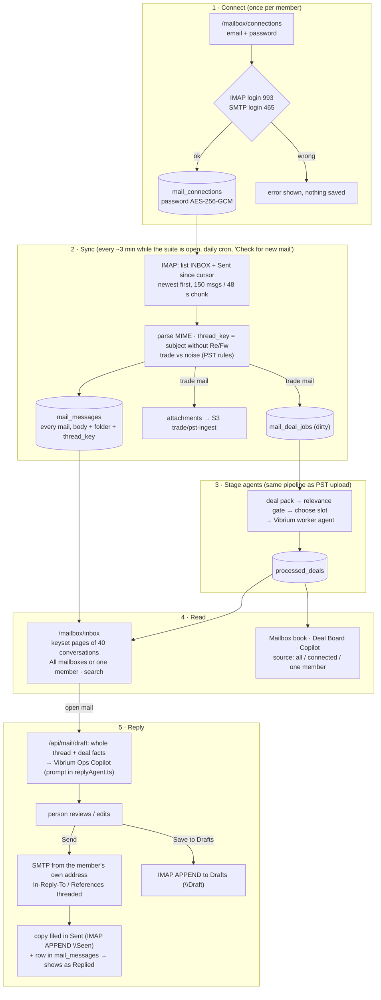

# Team mailboxes: shared inbox + deal book (IMAP / SMTP)

SNSPL mail is hosted on cPanel (`mail.snspl.in`), so every mailbox connects with its **email +
password**: IMAP to read, SMTP to send. Nothing is registered with Google or Microsoft.

There is no login yet, so this is a **shared workspace**. Every member connects their own mailbox
once, and everyone sees every connected mailbox in one inbox. The mailbox switcher shows
**All mailboxes** or one person.

## How it fits together

**Why the inbox reads from the store, not live IMAP:** one database query serves a page for one
mailbox or for all 15–20 together. It also allows search across all mail and keyset paging through
every conversation, with no 15 IMAP logins per page view and no load on the mail server. The sync
keeps the store within about 3 minutes of the server, and **Check for new mail** pulls straight away.

## Code map

| Piece | File |
|---|---|
| Connect + verify IMAP/SMTP | `src/app/api/mail/connections/route.ts`, `src/components/mail/imap-connect-form.tsx` |
| Sync engine (IMAP → store, trade filter, deal jobs) | `src/lib/mail/sync.ts`, `src/lib/mail/providers/imap.ts` |
| Conversation key | `src/lib/mail/thread.ts` (same rule as the SQL backfill in the Lambda) |
| Inbox pages, threads, replies | `src/lib/mail/inboxService.ts`, `src/lib/mail/inboxItems.ts` |
| SMTP send, Sent/Drafts filing | `src/lib/mail/imapMailbox.ts` |
| AI reply | `src/lib/mail/replyAgent.ts` (prompt) → Vibrium Ops Copilot bot (`VIBRIUM_OPS_COPILOT_BOT_ID`) |
| Quick drafts per stage | `src/lib/mail/replyDraft.ts` |
| Store (two backends) | `src/lib/mail/store.ts` → Lambda `infra/trade-suite-rds-proxy/handler.py` or Neon |
| UI | `/mailbox/inbox` (`src/components/mail/inbox/*`), `/mailbox/connections`, `/mailbox` (book) |

| PST script (Python) | Live mail (TypeScript) |
|---|---|
| `cluster_threads.py` noise / party_role / stage_of / po_key | `src/lib/mail/classify.ts` |
| `build_relevant_deals.py` deal pack + is_relevant | `src/lib/mail/dealPack.ts`, `classify.isRelevantDeal` |
| `process_deals.py` choose_slot / payload / evidence / cost | `classify.ts`, `sync.ts`, `workers.ts` |

**Keep the two in step.** If you change a domain list or regex in one, change the other.

## Where the data lives

| `TRADE_SUITE_DB_MODE` | Storage |
|---|---|
| `rds-proxy` (deployed) | Aurora schema `trade_suite` via the VPC Lambda `trade-suite-rds-proxy` (`infra/trade-suite-rds-proxy/`). After changing `handler.py`, deploy it and run `{"action":"migrate"}`. Migrations only add things (`ADD COLUMN IF NOT EXISTS`, indexes, backfill), so the running app is unaffected. |
| unset + `DATABASE_URL` | Neon. Tables and columns are created on first use. |

Tables: `mail_connections`, `mail_messages` (with `thread_key` and `folder`), `mail_deal_jobs`, and
`processed_deals`.

## Setup

1. **Env:** `MAIL_ENCRYPTION_KEY` (`openssl rand -base64 32`, the same value everywhere, never
   rotate) and `CRON_SECRET`. `MAIL_WORKSPACE_DOMAIN=snspl.in` is in the committed `.env.production`.
   Full list and deploy steps: [DEPLOY.md](DEPLOY.md).
2. **Connect mailboxes:** each member opens **Email connections → Connect a mailbox** and enters
   their email, mailbox password and name. Only `@snspl.in` is accepted. The server is decided on the
   backend: `mail.<domain>`, IMAP 993 / SMTP 465, which is what cPanel → Email Accounts → Connect
   Devices shows for snspl.in. `MAIL_IMAP_HOST` and its sibling variables override it only if the
   host moves.
3. **History:** a new mailbox imports the last 365 days (`MAIL_DEFAULT_BACKFILL_DAYS`, max 3650),
   newest first, about 150 messages per chunk. Each "Check for new mail" or auto-sync continues it.

## Operating notes

- **Wrong passwords:** cPanel blocks an IP after repeated failed logins (cPHulk). A changed password
  shows the mailbox as *Password needed*. Use **Update password** on Email connections.
- **Sent mail kept only on the PC:** some Outlook setups (POP3, or Sent Items stored locally) never put
  replies on the server. The app then can't see those replies, so those threads don't show as
  "Replied". Replies sent from the app are always recorded. To fix it, set Outlook to IMAP with Sent
  Items on the server.
- **Sending:** always through the member's own SMTP. Don't send `@snspl.in` mail through any other
  service: the domain's DMARC policy is `reject`, so it would bounce.
- **Disconnect** deletes the stored password and that mailbox's stored mail. Deals stay in the book.
- **Access:** anyone with the site URL can open every mailbox and send. Add login (or Vercel
  password protection) before inviting more people.

## Limits & tuning

| Env | Default | |
|---|---|---|
| `MAIL_REQUEST_BUDGET_S` | 48 | seconds of work per request (Vercel Hobby caps functions at 60 s) |
| `MAIL_MESSAGES_PER_RUN` | 150 | messages fetched per mailbox per request |
| `MAIL_JOBS_PER_RUN` | 10 | worker executions started per request |
| `MAIL_DEFAULT_BACKFILL_DAYS` | 365 | history for a new mailbox |
