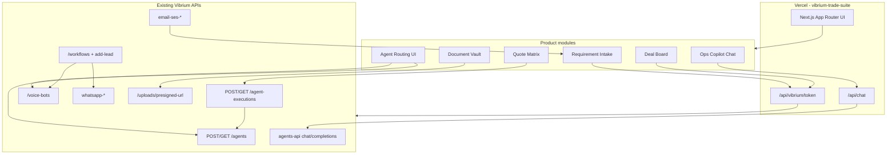

# Implementation plan (locked decisions) — historical

> Copied from the Cursor plan used to build Phase A. Status: Phase A shipped. Use this as the source of truth for architecture decisions when extending Phase B–G.

# Vibrium Trade — Sourcing Automation Plan (No New Domain APIs)

## Decisions locked

| Decision | Choice |
|----------|--------|
| Backend | **Existing Vibrium APIs only** — no `/trade` or `/sourcing` Lambdas |
| Agents | Worker (`AA*`) + Conversational (`VB*`) + Vibrium workflows |
| First build | **Phase A** (PPT steps 1–4): Requirement → Factory outreach → Quote → Buyer selection |
| Later | Sequential Phase B → G per process map in new repo `docs/` |
| Channels | Email + WhatsApp + Voice (as needed per step) |
| Tenant | Existing Vibrium org; service creds from [HR_Workflow](/Users/piyushjha/Documents/personal/HR_Workflow) / [payment_automation](/Users/piyushjha/Documents/personal/payment_automation) envs |
| Repo | **New repo** at `/Users/piyushjha/Documents/personal/vibrium-trade-suite` (sibling to HR/payment) |
| Deploy | **Vercel** (preview + production) |
| UI stack | **Next.js App Router** (matches [payment_automation](/Users/piyushjha/Documents/personal/payment_automation) for Vercel API routes) + HR modular product UX patterns |
| Reference docs | Copy process map + key Sourcing fixtures from [export_automation/docs](/Users/piyushjha/Documents/personal/export_automation/docs); leave demo UI in `export_automation` untouched |

## Architecture (existing APIs only)

### System of record without Trade APIs

Honest constraint: there is no durable multi-user Trade SoR on the backend. We use:

1. **Client deal store** (Zustand + persisted local/IndexedDB for single-org ops) holding Deal, parties, stage, linked `execution_id`s, `contact_id`s, S3 keys
2. **S3 via presigned upload** as document vault (folders `trade/rfq`, `trade/quotes`, …)
3. **Agent executions** as immutable AI audit trail (poll until completed; stash structured JSON on the Deal)
4. **Vibrium contacts + workflows** for outbound chase state (WhatsApp/voice/email outreach)
5. **Email SES threads** (existing `email-ses-threads-get` / inbound) as channel history when mailbox is registered for the org

If multi-user durable SoR becomes mandatory later, that is the point to add domain APIs — out of scope now.

### Patterns to copy

- **HR_Workflow**: modular shell, `vibriumClient` + token BFF, `pollUntil`, channel badges, agent routing UI, confidence/evidence chips — [HR_Workflow/src/services/vibriumClient.ts](/Users/piyushjha/Documents/personal/HR_Workflow/src/services/vibriumClient.ts)
- **payment_automation**: Next.js + Vercel, Ask-VIA chat proxy — [payment_automation/src/lib/vibrium/](/Users/piyushjha/Documents/personal/payment_automation/src/lib/vibrium), [src/app/api/chat](/Users/piyushjha/Documents/personal/payment_automation/src/app/api/chat)
- **tech-vibrium**: worker schemas + executions; workflow enroll via `add-lead`
- **Ground truth**: copy [Sourcing-Buying-Agency-Process-Map.md](/Users/piyushjha/Documents/personal/export_automation/docs/Sourcing-Buying-Agency-Process-Map.md) + Phase A fixtures into new repo `docs/`

---

## New repo + Vercel setup

### Repo

- Path: `/Users/piyushjha/Documents/personal/vibrium-trade-suite`
- GitHub remote (create when implementing): `vibrium-trade-suite`
- Package name: `vibrium-trade-suite`
- Do **not** modify `export_automation` product code; only copy docs/fixtures as needed

### Stack

| Layer | Choice |
|-------|--------|
| Framework | Next.js 15 App Router + React 19 + TypeScript |
| Styling | Tailwind CSS v4 + shared UI primitives (HR-like module shell) |
| State | Zustand (persisted deal store) |
| Auth to Vibrium | Server-only service account → JWT via `/api/vibrium/token` |
| Copilot | `/api/chat` + `/api/chat/start` proxy to agents-api (payment pattern) |
| Deploy | Vercel project linked to repo |

### Env (local + Vercel)

**Server-only (Vercel env / `.env.local`):**

- `VIBRIUM_API_BASE_URL` (staging: `https://api-staging.vibrium.ai`)
- `VIBRIUM_AGENTS_API_BASE_URL` (`https://agents-api.vibrium.ai`)
- `VIBRIUM_CUSTOMER_ID` (existing org)
- `VIBRIUM_SERVICE_USERNAME` / `VIBRIUM_SERVICE_PASSWORD`
- `VIBRIUM_OPS_COPILOT_BOT_ID` (VB* for web copilot)

**Public / client:**

- `NEXT_PUBLIC_VIBRIUM_CUSTOMER_ID` (optional display)
- `NEXT_PUBLIC_SITE_URL`

**Agent/workflow IDs** (after provisioning): `NEXT_PUBLIC_*` or SPA Agent Routing store for `requirement_extractor`, `quote_normalizer`, outreach VB*, workflow IDs.

Copy credentials from HR/payment `.env.local` — never commit secrets. Set the same keys in Vercel Project Settings → Environment Variables (Preview + Production).

### Deploy steps (Milestone 0)

1. `npx create-next-app` scaffold in new folder
2. Push to GitHub; `vercel link` / import project
3. Set env vars; deploy preview
4. Confirm `/api/vibrium/token` mints bearer against staging org
5. Production domain when Phase A demo-ready

---

## Phase A scope (MVP v1) — PPT steps 1–4

| Step | Human today | Automation |
|------|-------------|------------|
| 1 Buyer shares requirement | Email to SNSPL | Intake UI + **worker** extract + optional inbound email thread attach |
| 2 Agency approaches factories | Email/WA to factories | **Conversational** outreach workflow (WA/email/voice) + enroll `add-lead` |
| 3 Factory returns AS/quote sheet | Excel attachment | Upload → S3 → **worker** normalize to quote matrix |
| 4 Buyer reviews / selects | Forward + comments | Selection UI + **conversational** chase if buyer silent |

**Out of Phase A:** artwork, samples, PI/PO, barcodes, booking, payment (Phase B+).

### Sample artefacts to wire as fixtures

- Requirement email pattern: Petrageous leather toys (from process PPT)
- Quote: copy `AS LEATHER TOYS 6.3.25.xlsx` into new repo `docs/fixtures/`

---

## Agent roster (Phase A)

### Worker agents (`bot_kind: worker`) — create via existing `/agents`

| Slot ID | Job | Input | Output (JSON schema) |
|---------|-----|-------|----------------------|
| `requirement_extractor` | Parse buyer enquiry | `email_text` and/or `document_url` | product category, materials, target retail/factory cost, destination, buyer contacts, urgency, confidence |
| `quote_normalizer` | Parse AS/quote Excel | `document_url` (xlsx) | SKU rows: item code, description, image ref, MOQ, unit price, currency, packing notes; factory identity |

### Conversational agents (`VB*`)

| Slot ID | Channel | Job | Dispositions |
|---------|---------|-----|--------------|
| `factory_outreach` | WhatsApp (+ email if in workflow) | Ask factory for quote on brief | `QuotePromised`, `NeedClarification`, `Declined`, `EscalateToHuman` |
| `buyer_selection_chase` | WhatsApp / email | Nudge buyer to select SKUs | `Selected`, `NeedMoreTime`, `EscalateToHuman` |
| `ops_copilot` | Web chat (agents-api) | Deal Q&A from current deal context | N/A |

### Vibrium workflows (api-integrated)

1. **`wf_factory_outreach`** — WhatsApp agent → timeout chase → end on disposition
2. **`wf_buyer_selection_chase`** — same for buyer

Enroll: `POST .../add-lead` with `workflow_id`, phone/email, custom fields (`deal_id`, `product_brief`).

Routing map: SPA Agent Routing page + env defaults (no new Trade routing APIs).

---

## Product UI modules (Phase A)

1. **Overview** — product narrative + enter app  
2. **Deal Board** — stages: `requirement | outreach | quoting | selection` (later stages visible but disabled)  
3. **Deal Room** — timeline, parties, channels, docs, executions  
4. **Requirement Intake** — paste/upload → worker → confirm → Deal  
5. **Quotes** — AS sheet → worker → matrix → selection lock  
6. **Outreach** — enroll factory workflow; show dispositions  
7. **Document Vault** — S3 keys by deal  
8. **Agent Routing** — slot → AA*/VB*/workflow IDs  
9. **Ops Copilot** — floating + `/support`-style page (payment pattern)

Channel type on timeline events: `email | whatsapp | voice | portal`.

---

## Build sequence

### Milestone 0 — New repo + Vercel foundation

- Create `vibrium-trade-suite` Next.js app
- Port vibrium auth/chat BFF from payment_automation; client patterns from HR
- Deal types + Zustand store
- Copy process map + Phase A fixtures into `docs/`
- Wire Vercel project + staging env; green preview deploy
- Smoke: token mint + list agents/voice-bots for org

### Milestone 1 — Worker loop

- Provision `requirement_extractor` + `quote_normalizer` on staging
- Intake + quote matrix UI; fixture golden path

### Milestone 2 — Conversational outreach

- Provision VB* + api-integrated workflows; enroll from Deal Room; timeline dispositions

### Milestone 3 — Channels + copilot

- Email SES threads; WA/voice as needed; Ops Copilot on Vercel

### Milestone 4 — Handoff

- Agent routing UI; runbook (IDs, env, Vercel); stage machine ready for Phase B; production promote

---

## Later phases (sequential — not in v1)

| Phase | Workers | Conversational |
|-------|---------|----------------|
| B Artwork/samples | artwork checklist extract | sample chase WA |
| C PI/PO | PI/PO extract + discrepancy | PO ack chase |
| D Spec/barcode/pack | barcode/UPC match | approval chase |
| E Production/QC | inspection summary | production follow-up |
| F Booking | booking PDF extract | sailing confirm |
| G Docs/pay/commission | CI/PL/BL pack check; payment clock | release/payment reminders |

---

## Explicit non-goals (v1)

- New Vibrium Lambdas / `/trade/*` APIs  
- Changing or redeploying `export_automation` demo  
- Automating Phases B–G in the first ship  
- Multi-tenant SaaS beyond one existing org  

---

## Risks and mitigations

| Risk | Mitigation |
|------|------------|
| No shared SoR across users | Single-ops org; executions + S3; revisit APIs later |
| Excel quote parsing quality | Constrain to AS LEATHER TOYS shape; human confirm |
| WA template lag | Email SES + web first; WA when templates ready |
| Secrets on Vercel | Server-only env; no `NEXT_PUBLIC_` for passwords |
| Fixture size (xlsx/images) | Small fixtures in repo; large WeTransfer stays in export_automation |

---

## Locked demo script (Phase A)

Petrageous-style enquiry → factory outreach → AS LEATHER TOYS normalize → buyer selection.

When Phase A is green on Vercel, next build is **Phase B** (artwork/samples) unless reprioritized.
